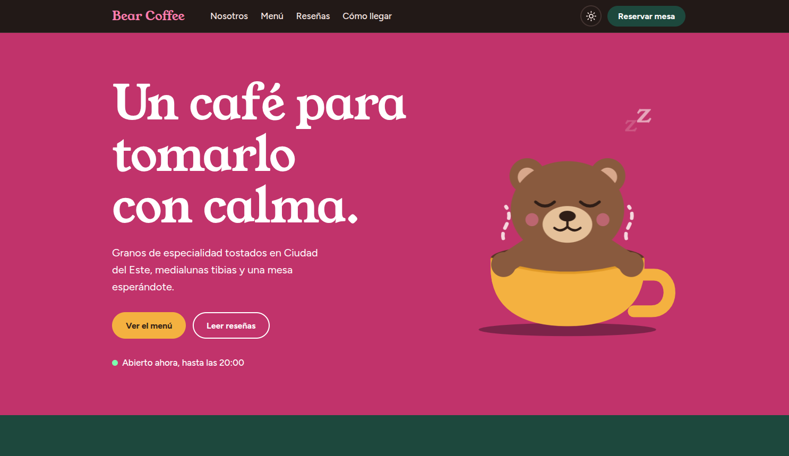

# Bear Coffee · Landing page para cafetería

Landing page de muestra para una cafetería. Pensada para publicitar el local, atraer nuevos clientes y recoger reseñas que ayuden a mejorar el servicio.

**Demo:** `https://TU-USUARIO.github.io/coffee-shop-landing/`



## Qué incluye

- **Hero con oso animado** dibujado en SVG: respira, flota vapor y ondas en el café.
- **Estado en vivo** del local ("Abierto ahora" / "Cerrado ahora") según el horario.
- **Menú por categorías** (café, frío y para comer) con pestañas.
- **Reseñas de clientes** con promedio, distribución por estrellas y un carrusel que avanza solo.
- **Formulario de reseña** con nombre, puntuación, comentario y un campo opcional de sugerencias de mejora.
- **Horarios** con el día actual resaltado y botón de reserva por WhatsApp.
- **Modo claro y oscuro** con botón, que recuerda la elección y sigue al sistema si no se eligió.
- **Responsiva** para celular, tablet y escritorio.
- **Accesible:** navegación por teclado, etiquetas para lectores de pantalla y respeto por la preferencia de movimiento reducido.

## Tecnologías

HTML, CSS y JavaScript puros, sin frameworks ni dependencias. Solo se cargan las tipografías Young Serif y Figtree desde Google Fonts.

## Estructura

```
coffee-shop-landing/
├── index.html
├── styles.css
├── script.js
├── favicon.svg
├── apple-touch-icon.png
└── README.md
```

## Cómo verla en tu computadora

Abrí `index.html` en el navegador. No hace falta instalar nada.

## Cómo personalizarla

Todo el contenido de ejemplo es ficticio. Para adaptarla a un cliente real:

- **Datos del local:** dirección, teléfono, redes y enlaces de WhatsApp en `index.html`.
- **Horarios:** la lista `H` al inicio de `script.js` (día, hora de apertura y de cierre).
- **Menú y precios:** el objeto `M` en `script.js`.
- **Reseñas de ejemplo:** la lista `seed` en `script.js`.
- **Colores y tipografías:** las variables al inicio de `styles.css`.
- **Velocidad del carrusel:** el valor `2800` (milisegundos) en `script.js`.
- **Mapa:** reemplazá el bloque `.map` por un iframe de Google Maps.

## Limitaciones conocidas

- Las reseñas se guardan en el navegador de cada visitante (`localStorage`), por lo que no se comparten entre personas. Para un sitio real hay que conectar el formulario a un servicio como Supabase, Firebase o Formspree.
- El estado "Abierto ahora" usa la hora del dispositivo del visitante, no la de Paraguay.

## Publicar en GitHub Pages

1. Subí los archivos a un repositorio público.
2. En **Settings → Pages**, elegí **Deploy from a branch**, la rama `main` y la carpeta `/ (root)`.
3. Esperá un par de minutos y abrí el enlace que aparece en esa misma pantalla.

## Autoría

Diseñado y desarrollado por [Andrea Servín](https://www.linkedin.com/in/andreaservin-ing).
